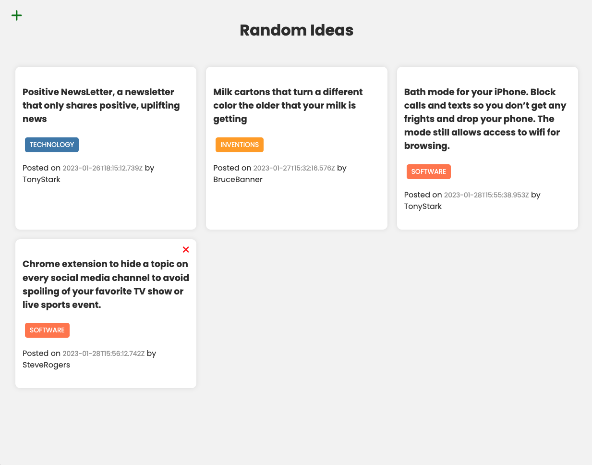

# RandomIdeas App

This is a fullstack application for sharing random ideas. It is a project in my **Modern JS From The Beginning** course.

This app includes a Node.js/Express REST API that uses MongoDB for a database. The client-side is built with Webpack.



## Project Overview

RandomIdeas is the full-stack version of the ideas app. The backend serves the API and the production frontend, while the frontend uses modular JavaScript classes to fetch, render, create, and delete ideas in the browser.

The app stores ideas in MongoDB with a Mongoose model. Each idea has text, a tag, a username, and a date. The username is also stored in `localStorage` so the client can show delete controls for ideas created by the current user.

## App Structure

- `server.js` sets up Express, connects to MongoDB, serves the `public` folder, enables CORS, parses request bodies, and mounts the ideas API routes.
- `config/db.js` connects Mongoose with the `MONGO_URI` environment variable.
- `models/Idea.js` defines the MongoDB idea schema.
- `routes/ideas.js` contains the REST API routes for getting, creating, updating, and deleting ideas.
- `client/src/index.js` boots the frontend by creating the modal, form, and idea list classes.
- `client/src/services/ideasApi.js` wraps the API requests with Axios.
- `client/src/components/` contains the modal, form, and idea list UI classes.
- `client/src/css/style.css` contains the app styles used by Webpack.
- `public/` contains the built frontend files served by Express in production.
- `assets/screen.png` is the project screenshot used in this README.

## What This Covers

- Building a full-stack app with Express and a bundled frontend.
- Serving static production assets from an Express backend.
- Using CORS for local frontend/backend development.
- Connecting to MongoDB with Mongoose and dotenv.
- Organizing backend routes, models, and database configuration.
- Creating frontend modules with Webpack and Babel.
- Making API requests with Axios.
- Rendering API data into the DOM.
- Using a modal form to create new ideas.
- Saving the current username in `localStorage`.
- Protecting update and delete routes by matching usernames.

## Usage

### Install Dependencies

Install dependencies on the front-end and back-end

```bash
npm install
cd client
npm install
```

### Back-end/Express Server

```bash
npm start
```

or

```bash
npm run dev (Nodemon)
```

Visit `http://localhost:5000`

### Front-end/Webpack Dev Server

```bash
cd client
npm run dev
```

Visit `http://localhost:3000`

To build front-end production files

```bash
cd client
npm run build
```

The production build will be put into the `public` folder, which is the Express static folder.

### Environment Variables

Rename `.env-example` to `.env` and add your MongoDB URI to the `.env` file

```
MONGO_URI=your_mongodb_uri
```

## REST Endpoints

### Ideas

| Endpoint       | Description    | Method | Body                    |
| -------------- | -------------- | ------ | ----------------------- |
| /api/ideas     | Get all ideas  | GET    | None                    |
| /api/ideas/:id | Get idea by id | GET    | None                    |
| /api/ideas     | Add idea       | POST   | { text, tag, username } |
| /api/ideas/:id | Update idea    | PUT    | { text, tag, username } |
| /api/ideas/:id | Delete idea    | DELETE | username                |

When updating or deleting, the username must match the username of the idea creator.
