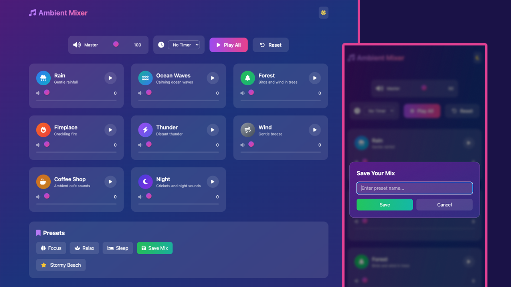

# Ambient Sound Mixer 🎵

Create your perfect atmosphere with this beautiful and intuitive ambient sound mixer. Mix and match various nature sounds, white noise, and ambient audio to enhance focus, relaxation, or sleep.



## Project Overview

The Ambient Sound Mixer is a browser-based audio mixing project built with plain HTML, Tailwind via CDN, custom CSS, and ES modules. It dynamically renders sound cards from `js/soundData.js`, loads each MP3 into reusable audio elements, and lets the user combine multiple looping ambient tracks into one custom soundscape.

The app is organized around small classes: `AmbientMixer` coordinates the app, `SoundManager` owns audio playback, `PresetManager` saves custom mixes, `Timer` handles countdown behavior, and `UI` updates the page. This keeps the audio logic, persisted preset data, timer state, and DOM rendering separated instead of packed into one script.

The project can run by opening `index.html` directly in the browser. For the smoothest local development experience, use a small static server so the ES module imports and MP3 paths load consistently.

## How The App Works

1. `app.js` initializes the app after `DOMContentLoaded`.
2. `soundData.js` provides the list of available sounds and the default Focus, Relax, and Sleep presets.
3. `UI.renderSoundCards()` creates the sound cards from the sound data.
4. `SoundManager.loadSound()` creates looping audio elements for each file in `audio/`.
5. Slider changes update each sound's volume and combine with the master volume.
6. Presets set multiple sound volumes at once, then start the matching audio files.
7. Custom presets are saved in `localStorage` under `ambientMixerPresets`.
8. The timer pauses all sounds and resets the timer display when it finishes.

## ✨ Features

### 🎛️ Sound Mixing

- **8 Bundled Ambient Sounds** - Rain, thunderstorm, ocean waves, forest birds, fireplace, wind, coffee shop ambience, and night sounds
- **Individual Volume Controls** - Fine-tune each sound independently with smooth volume sliders
- **Master Volume Control** - Adjust overall mix volume instantly
- **Play/Pause Individual Sounds** - Toggle sounds on/off while maintaining volume settings
- **Visual Feedback** - Animated sound cards with hover effects and play state indicators

### 🎨 Presets & Customization

- **Built-in Presets** - Quick access to pre-made mixes:
  - 🧠 **Focus** - Optimized for concentration and productivity
  - 🧘 **Relax** - Perfect for meditation and unwinding
  - 😴 **Sleep** - Gentle sounds to help you fall asleep
- **Save Custom Presets** - Create and save your own perfect sound combinations
- **Persistent Storage** - Your custom presets are saved locally and available on return visits
- **Delete Custom Presets** - Remove unwanted saved presets with a simple click

### ⏱️ Timer Features

- **Sleep Timer** - Set automatic stop timers (5, 15, 30, or 60 minutes)
- **Visual Countdown** - See remaining time at a glance
- **Auto-Stop** - All sounds fade out smoothly when timer expires

### 🎨 User Interface

- **Dark/Light Theme Toggle** - Switch between beautiful dark and light color schemes
- **Responsive Design** - Works perfectly on desktop, tablet, and mobile devices
- **Smooth Animations** - Polished transitions and hover effects
- **Gradient Backgrounds** - Dynamic color gradients that adapt to theme
- **Backdrop Blur Effects** - Modern glassmorphism design elements

### 🔧 Technical Features

- **No Installation Required** - Runs directly in your browser
- **Offline Support** - Once loaded, works without internet connection
- **LocalStorage Integration** - Saves your preferences and custom presets
- **Modular Architecture** - Clean, maintainable code structure
- **ES6 Modules** - Modern JavaScript with proper separation of concerns

## 🚀 Getting Started

### Quick Start

1. Clone or download this repository
2. Open `index.html` in your web browser
3. Start mixing your perfect ambient soundscape!

### Local Development

```bash
# Clone the repository
git clone https://github.com/yourusername/ambient-sound-mixer.git

# Navigate to project directory
cd ambient-sound-mixer

# Open in browser (or use a local server)
open index.html

# For development with live reload (optional)
# You can use any static file server like:
npx serve
# or
python -m http.server 8000
```

## 📁 Project Structure

```
ambient-sound-mixer/
├── index.html              # Main HTML file
├── css/
│   └── styles.css         # Custom styles and animations
├── js/
│   ├── app.js            # Main application logic
│   ├── soundData.js     # Sound definitions and presets
│   ├── soundManager.js  # Audio handling and playback
│   ├── presetManager.js # Preset save/load functionality
│   ├── timer.js         # Timer implementation
│   └── ui.js            # UI components and interactions
├── audio/               # Audio files directory
│   ├── rain.mp3
│   ├── ocean.mp3
│   ├── birds.mp3
│   ├── cafe.mp3
│   ├── fireplace.mp3
│   ├── night.mp3
│   ├── thunder.mp3
│   ├── wind.mp3
│   └── README.md
└── screen.png           # Application screenshot

```

## 🎵 Available Sounds

- 🌧️ **Rain** - Gentle rainfall
- 🌊 **Ocean Waves** - Calming ocean waves
- 🌲 **Forest** - Birds and wind in trees
- 🔥 **Fireplace** - Crackling fire
- ⚡ **Thunder** - Distant thunder
- 💨 **Wind** - Gentle breeze
- ☕ **Coffee Shop** - Ambient cafe sounds
- 🌙 **Night** - Crickets and night sounds

The sound metadata lives in `js/soundData.js`, so adding another sound means adding the MP3 file to `audio/` and adding a matching sound object to the `sounds` array.

## JavaScript Modules

- `app.js` wires together all managers, event listeners, presets, volume changes, reset behavior, and timer completion.
- `soundManager.js` loads, plays, pauses, stops, loops, and volume-controls the audio elements.
- `presetManager.js` reads and writes custom presets in `localStorage`.
- `timer.js` manages countdown state with `setInterval()`.
- `ui.js` creates sound cards, updates buttons, controls the save modal, renders custom presets, updates timer text, and toggles the theme.
- `soundData.js` stores the sound list and default preset configurations.

## Data Stored In The Browser

Custom presets are saved locally in the user's browser. The app stores only preset names and active sound volume values, not audio files. Clearing browser storage will remove saved custom presets.

## 💡 Usage Tips

### Creating the Perfect Mix

1. Start with a base sound (rain, ocean, or white noise)
2. Layer in complementary sounds at lower volumes
3. Adjust master volume to comfortable level
4. Save your mix as a custom preset for quick access

### Recommended Combinations

- **Deep Focus**: White noise (50%) + Rain (30%) + Coffee shop (20%)
- **Meditation**: Ocean waves (60%) + Wind (20%) + Forest (20%)
- **Cozy Evening**: Fireplace (70%) + Rain (30%)
- **Sleep Aid**: Pink noise (40%) + Ocean waves (30%) + Wind (30%)

## 🛠️ Technologies Used

- **HTML5** - Semantic markup
- **Tailwind CSS** - Utility-first styling
- **JavaScript (ES6+)** - Modern JavaScript with modules
- **Font Awesome** - Icon library
- **Browser Audio API** - Audio playback and control with looping audio elements
- **LocalStorage API** - Persistent data storage

## 📝 Browser Compatibility

- Chrome 90+
- Firefox 88+
- Safari 14+
- Edge 90+
- Opera 76+

## 🤝 Contributing

Contributions are welcome! Feel free to:

1. Fork the repository
2. Create a feature branch
3. Make your changes
4. Submit a pull request

### Ideas for Contribution

- Add more ambient sounds
- Create additional preset collections
- Implement keyboard shortcuts
- Add sound visualization
- Create a PWA version
- Add cross-device sync

## 📄 License

This project is open source and available under the MIT License.

## 🙏 Acknowledgments

- Sound files sourced from royalty-free libraries
- Icons provided by Font Awesome
- Tailwind CSS for the beautiful styling system

## 📧 Contact

For questions, suggestions, or issues, please open an issue on GitHub or contact the maintainer.

---

**Enjoy creating your perfect ambient atmosphere! 🎧**
